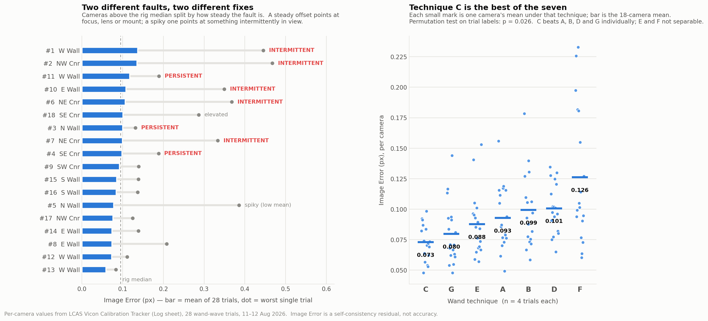

# Wand Wave Frame Analysis — screenshots, per-camera error, and what the two together show

**Revision 2.** Rewritten after the per-camera log from `LCAS Vicon Calibration Tracker.xlsx` was added. The first pass worked only from trial-level summaries; several conclusions have changed, and one has been overturned.

**Data:** 28 wand-wave trials and 17 daily calibrations, per camera (504 + 306 observations), plus 15 error/experiment sets; 33 Nexus Camera-view screenshots reduced to per-camera sensor-coverage metrics. Vicon Nexus 2.18, 18 × Vero v2.2.

---

## What changed with the per-camera data

| First pass said | Now |
|---|---|
| Coverage weakly predicts error (ρ ≈ +0.4, didn't survive correction) | **Overturned.** Once camera identity and trial identity are removed, coverage has *no* relationship to error (ρ = 0.018, p = 0.69). |
| Coverage ↔ World Error looked meaningful | **Explained away.** It is a distance artefact — quantified in §3. |
| #11, #1, #2 worth checking | **Confirmed and sharpened** into two distinct fault types with different remedies (§2). |
| Technique C looks best, heavily caveated | **Holds up.** C's four trials beat every trial of A, B, D and G — complete separation (§4). |
| Wand count doesn't predict error | **Confirmed by controlled experiment** — +82% frames, no change (§5). |

---

## 1. Headline

Your calibration error is dominated by **which camera** and **which trial**, not by how much of each sensor the wand reached.

Variance in per-camera Image Error across the 28 trials:

- **19.8%** explained by camera identity
- **31.4%** explained by trial identity (technique, time of day, whatever else varies run to run)
- **0%** by sensor coverage, once those two are accounted for

So the screenshots were worth processing — but as a *diagnostic aid* for interpreting individual cameras, not as a predictor of error. The real levers are the four cameras in §2 and the technique choice in §4.

---

## 2. Camera priority list — two fault types, two fixes

Mean Image Error across 28 wand-wave trials, with the coefficient of variation separating steady faults from intermittent ones:

| Camera | Mean IE (px) | CV | Worst trial | Coverage | Verdict |
|---|---|---|---|---|---|
| **#1 W Wall C1** | 0.137 | 0.52 | 0.445 | 0.505 | **Intermittent** |
| **#2 NW Corner C2** | 0.135 | 0.54 | 0.467 | 0.478 | **Intermittent** |
| **#11 W Wall C11** | 0.117 | 0.28 | 0.189 | 0.544 | **Persistent** |
| **#10 E Wall C10** | 0.108 | 0.49 | 0.350 | 0.560 | **Intermittent** |
| **#6 NE Corner C6** | 0.106 | 0.66 | 0.368 | 0.293 | **Intermittent** |
| #18 SE Corner C18 | 0.101 | 0.44 | 0.287 | 0.325 | Elevated |
| **#3 N Wall C3** | 0.100 | 0.13 | 0.132 | 0.275 | **Persistent** |
| **#7 NE Corner C7** | 0.099 | 0.54 | 0.333 | 0.329 | **Intermittent** |
| **#4 SE Corner C4** | 0.098 | 0.25 | 0.188 | 0.291 | **Persistent** |
| *rig median* | *0.085* | | | | |
| #5 N Wall C5 | 0.078 | **0.83** | 0.386 | 0.383 | Spiky — fine on average, occasionally 5× its own mean |
| #12, #13, #14, #8, #17 | 0.059–0.076 | low | | | Healthy |

**Persistent (#11, #3, #4)** — consistently above median, low variance. A steady offset that appears in every trial regardless of technique is a *fixed* property: focus at the working distance, lens or mount geometry, or a permanent mask eating usable sensor. Vicon's optical guidance is the checklist here — check focus with Grayscale Mode set to All, keep Gain at its default x1 ("only adjust this setting if the markers appear too faint … Vicon advises against exceeding x2"), keep Strobe Intensity at 1, and set Threshold within 0.2–0.5.[^1] **#11 is the priority**: worst persistent offset, and it has *high* sensor coverage, so it cannot be blamed on being under-served by the wand.

**Intermittent (#1, #2, #10, #6, #7)** — high mean carried by occasional spikes to 3–3.5× their own average. Something enters these cameras' view sometimes and not others. Vicon's prerequisite is to "remove from the capture volume all markers and the sources of any unwanted reflections," and to "adjust camera settings first" and only "if adjusting these settings does not easily enable you to eliminate reflections, create camera masks."[^1] Note that masking costs you real coverage, so settings first. **#1 and #2 are the priority** — highest means and the two worst single-trial values on the rig.

**#5 is worth a separate note.** Its mean is *below* the rig median, but its worst trial is 0.386 px — 4.9× its own mean, the largest spike ratio on the rig. It would never appear in a mean-based review. It is a reflection/stray-marker candidate that only shows up on some runs.

**#9 (SW Corner C9) — do not touch.** It has the *most* wand frames in 24 of 28 trials and looks bad on World Error, but its Image Error is fine (0.092, below median, CV 0.23). §3 explains why.

*Watch item, not yet a finding:* across the 17 dailies, #9's Image Error trends upward (ρ = +0.55, p = 0.021) and #18's downward (ρ = −0.49, p = 0.047). Neither survives correction for 18 cameras tested — flag them for the next month of logging rather than acting now.

---

## 3. World Error vs Image Error — and why the coverage link was a mirage

World Error "is calculated per camera from the Image Error in pixels and the distance of the camera to the center of the volume."[^2] The data lets you recover that conversion factor directly. Per camera, k = WE / IE:

| k ≈ 3.0–3.7 (near cameras) | k ≈ 4.1–4.4 (mid) | k ≈ 4.8–5.1 (far cameras) |
|---|---|---|
| #11 3.04, #14 3.13, #12 3.21, #8 3.32, #1 3.56, #10 3.68 | #13 4.12, #5 4.23, #3 4.26, #15 4.37, #16 4.40 | #6 4.78, #17 4.82, #7 4.82, #18 4.94, #4 5.04, #9 5.10 |

Two properties make this useful:

**It is extremely stable.** Within-camera coefficient of variation is **1.3–3.5%** across the entire 25 Jul – 14 Aug log. It varies 68% *between* cameras and barely at all *within* one.

**That makes it a rig-movement detector.** A camera that gets bumped, or has its zoom or focus ring moved, changes its distance-to-volume or its pixel scale — and k steps. Testing all 18 cameras for drift over the logging period found nothing convincing (no camera with p < 0.01 and |ρ| > 0.5). **Your rig geometry has not moved in three weeks.** That is worth knowing, and worth adding as a column to the tracker: it costs nothing and it distinguishes "a camera got knocked" from "the calibration was poor today" — a distinction the raw error figures cannot make.

**And it explains the coverage result from the first pass.** Within any single trial, comparing across cameras:

- sensor coverage vs **World Error**: ρ = −0.21, negative in **27 of 27** trials (p = 1.5 × 10⁻⁸)
- sensor coverage vs **Image Error**: ρ = +0.06, no effect (p = 0.44)

Cameras nearer the volume see the wand across more of their sensor *and* have a smaller mm-per-pixel factor. So they post lower World Error for purely geometric reasons. **The coverage → World Error relationship is distance wearing a disguise.** Image Error, which is the fair within-camera measure, shows nothing.

Consequence for your log: **stop treating mean World Error as a quality number.** Across the trials WE and IE correlate at r = 0.9986, so the system means carry identical information; the per-camera split is where WE and IE diverge, and that divergence is geometry, not quality. Image Error is the number to trend per camera.

---

## 4. Technique C, properly tested

Using per-camera Image Error with technique labels permuted at the **trial** level (cameras within a trial are correlated, so any test treating 18 cameras as independent replicates is over-confident):

| Technique | Mean IE (px) | vs C |
|---|---|---|
| **C** | **0.0730** | — |
| G | 0.0797 | +0.0067, p = 0.030 |
| E | 0.0876 | +0.0146, p = 0.34 |
| A | 0.0929 | +0.0198, p = 0.027 |
| B | 0.0994 | +0.0263, p = 0.028 |
| D | 0.1007 | +0.0277, p = 0.025 |
| F | 0.1262 | +0.0532, p = 0.057 |

Overall technique effect: **permutation p = 0.026**.

The pairwise p-values all sit at ≈0.026–0.030 for a reason worth understanding: with 4 trials versus 4, the smallest two-sided permutation p attainable is 2/70 = **0.029**. Those comparisons are at the floor, which means **complete separation** — every one of C's four trials produced lower mean Image Error than every trial of A, B, D and G. That is as strong a result as this design can produce. E and F each have one trial that beats C's worst, so those two are not separable from C.

**Two caveats that have not gone away.** On 11 Aug the techniques ran in strict sequence (A 11:22 → B 12:31 → C 13:47 → D 14:05 → E 14:20), so technique is confounded with time-of-day and thermal state on that day; Vicon documents warm-up dependence of 30–90 minutes.[^3] And C4 ran on 12 Aug at 13:39, still in the afternoon. To settle it, run C and B alternating across a morning and an afternoon.

**Technique F does something different in kind.** Rank-correlating which cameras suffer most between techniques: A↔B is 0.95, C↔G is 0.86 — the same cameras are worst regardless. But F correlates only 0.14–0.48 with the others. F does not just raise the average, it **redistributes** error to different cameras unpredictably. Whatever F is, it is the one to drop.

---

## 5. Auto-stop: a clean null result

The `auto-stop-1000 / 1500 / 2000` sets are a controlled experiment on the same rig, 18 cameras each:

| Auto-stop | Mean frames | Mean Image Error |
|---|---|---|
| 1000 | 1,856 | 0.0911 |
| 1500 | 2,657 | 0.0951 |
| 2000 | 3,374 | 0.0904 |

Friedman across the three levels, 18 cameras paired: **p = 0.25**. 1000 vs 2000 directly: p = 0.39, on **82% more wand data**.

Collecting more frames does not improve the calibration. This matches the trial data (frame count vs error, ρ = +0.09, p = 0.64 across 27 trials) and matches the documentation's framing: Auto Stop Minimum Frames is the point at which "sufficient data has been collected,"[^4] a floor rather than a quality target — and since Vicon states it "is not possible to provide general guidelines on typical or acceptable ranges" and directs users to their own baseline,[^5] a higher wand count is not itself evidence of a better calibration. **Keep auto-stop at 1000 and spend the time on coverage of the cameras in §2 instead.**

---

## 6. A scale for "how bad is bad"

Your error sets provide the reference points your log otherwise lacks:

| Set | Mean IE (px) | Max WE (mm) | Relative to normal |
|---|---|---|---|
| Wand-wave trials (median) | 0.085 | — | baseline |
| Wand-wave trials (95th pct) | 0.154 | — | 1.8× |
| `shelf-baseline` / `shelf-trial` | 0.101 / 0.108 | 0.75 / 0.95 | 1.2–1.3× |
| `cannot-set-volume` | 0.104 | 0.61 | 1.2× |
| **`didn't-set-volume`** | **0.281** | **3.28** | **3.3×** |

`didn't-set-volume` is what a genuinely broken calibration looks like in these units. Everything else in your log — including F3, your worst wand wave at 0.209 px — sits well inside the normal band. Worth having on the wall: **below ~0.15 px mean IE is a normal day; 0.28 px means something structural is wrong.**

---

## 7. Where the sensor-coverage measurements still earn their place

They do not predict error. What they do is stop you misreading it:

- **#11 has high coverage and persistently high Image Error** — so its error cannot be excused as "the wand didn't reach it." Without the screenshots that ambiguity is unresolvable.
- **#13 has the rig's lowest Image Error (0.059) on the 5th-lowest coverage (0.308).** Its excellent number was earned on a smaller sample of its own sensor than #12's (0.073 on coverage 0.828). Not proof of anything, but a reason to weight #12's number more heavily.
- **#3, #8, #4, #6 sit at the bottom of the coverage table in almost every trial** — three of them corner or end-wall cameras. Vicon's own troubleshooting guidance is to "try to ensure that cameras on two or three adjacent walls or two opposing walls can collect wand frames at the same time" and to "avoid only waving the wand close to the edge of the volume where only 2 or 3 cameras may see the wand at the same time."[^6] Two of those four (#3, #4) are also persistent-fault cameras, so improving their coverage is worth doing before concluding they are faulty.
- Per-camera frame count and sensor coverage correlate at ρ = 0.36 pooled, positive in **27 of 27** trials — the extraction agrees with the log's own frame counts, which is what validates the whole image pipeline.

---

## 8. Suggested actions

1. **Inspect #1 and #2** for intermittent reflections or stray markers — settings before masks.[^1] These two carry the rig's worst mean and worst single-trial Image Error.
2. **Inspect #11** for focus and mount rigidity. Its fault is steady, not intermittent, and it is not a coverage problem.
3. **Add a `WE/IE` column per camera** to the tracker. It is a free, extremely stable rig-geometry fingerprint; a step change means a camera moved.
4. **Trend Image Error, not World Error, per camera.** World Error's between-camera differences are dominated by distance.
5. **Drop technique F** — it is worst on average and it scrambles which cameras suffer.
6. **Leave auto-stop at 1000.**
7. **Settle the C-vs-time-of-day confound** by alternating C with one comparator across a morning and an afternoon.
8. **Fix the log:** A4 and F1 both record 12/08/2026 11:05:00 with different temperatures (25.0 vs 24.5 °C); same for B4 and F2 at 11:13:00.

---

## Files

| File | Contents |
|---|---|
| `wand_wave_manifest.json` | v2 — 45 records (28 trials + 17 dailies). Every record now carries per-camera Frame Count, World Error, Image Error and WE/IE ratio; the 33 with screenshots also carry 10 sensor-coverage metrics per camera. Includes method notes, metric definitions and known gaps. |
| `camera_priority.png` | The figure above. |
| `wand_wave_analysis.png` | First-pass figure: per-camera coverage and technique-vs-coverage. |
| `wand_wave_analysis.md` | This report. |

---

## What these numbers are not

Image Error is the residual of the calibration fit against the wand data it was given — self-consistency, not metric accuracy. Vicon states that "because calibration feedback values are based on factors such as the size of the capture volume and the camera lens type, it is not possible to provide general guidelines on typical or acceptable ranges," and directs users to "establish a baseline against which you can compare future daily calibration values."[^5] Everything above is measured against your own baseline, which is the only frame in which these numbers mean anything. A calibration can post excellent figures while being wrong in parts of the volume the wand never reached — which is the reason the coverage measurements are worth keeping beside the error figures even though they do not predict it.

---

### Sources

Vicon documentation citations are carried from the project's sourced document `claude/image-error-and-world-error.md`; [^5] and [^6] were re-verified against Vicon's live pages during this analysis. All statistical results are derived from your own calibration tracker and screenshots and are not Vicon claims.

[^1]: Vicon, *Configure Vicon optical cameras for data capture* — Nexus 2.18. https://vicon-help.atlassian.net/wiki/spaces/Nexus218/pages/406487820/Configure+Vicon+optical+cameras+for+data+capture
[^2]: Vicon, *System Preparation tools* — Nexus 2.18. https://vicon-help.atlassian.net/wiki/spaces/Nexus218/pages/406490496/System+Preparation+tools
[^3]: Vicon, FAQ: *How much time do Vicon cameras need to warm-up prior to use?* https://www.vicon.com/support/faqs/how-much-time-do-vicon-cameras-need-to-warm-up-prior-to-use/
[^4]: Vicon, *Camera calibration parameters* — Tracker 3.10. https://vicon-help.atlassian.net/wiki/spaces/Tracker310/pages/13928716/Camera+calibration+parameters
[^5]: Vicon, *Calibrate Vicon cameras* — Tracker 3.10. https://vicon-help.atlassian.net/wiki/spaces/Tracker310/pages/13928809/Calibrate+Vicon+cameras
[^6]: Vicon, FAQ: *Why do I occasionally see duplicate markers in the 3D Workspace after I calibrate?* https://www.vicon.com/support/faqs/why-do-i-occasionally-see-duplicate-markers-in-the-3d-workspace-after-i-calibrate/
