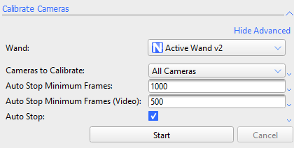
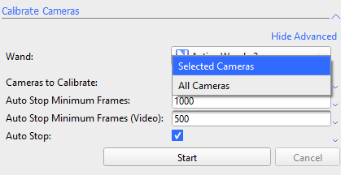
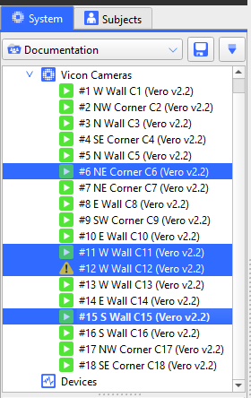
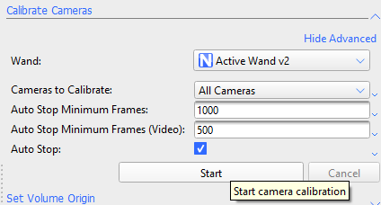

---
tags:
  - Vicon
  - Documentation
  - Live
  - Calibration
Section: "[[Public Files/Vicon System Documentation/system_preparation/index (system_preparation)|System Preparation]]"
Chapter: Calibrating Cameras
Chapter Number: "3"
Page Title: Calibrating Cameras
Page Number: "1"
Page Status: Draft
Software:
  - Vicon Nexus 2.18
Next Page:
  - "[[Public Files/Vicon System Documentation/system_preparation/3_calibrating/3_2_wand_waving|3_2_wand_waving]]"
  - "[[Public Files/Vicon System Documentation/system_preparation/4_volume/4_1_set_volume_origin|4_1_set_volume_origin]]"
Last Page:
  - "[[Public Files/Vicon System Documentation/system_preparation/1_masking/1_2_reflections_and_manual_masking|1_2_reflections_and_manual_masking]]"
  - "[[Public Files/Vicon System Documentation/system_preparation/1_masking/1_1_masking|1_1_masking]]"
---
---
```table-of-contents
```
---
---
# Introduction

*Placeholder - write what this guide covers, and why it is important*

**This guide covers:**
- Topic
- Topic

---
---

# Title
*As doc name*

This guide is intended for default calibration, not advanced, anything that can be done in further detail should be moved to a sub-guide where appropriate

*Daily calibration is recommended, any time you plan to start a new capture session if the environment has changed or been disturbed* - r**eview note what disturbs this**

*calibration allows cameras to determine their relative positions and focal lengths*
## Starting Calibration

*You must toggle live mode*


*Toggle advanced properties to confirm everything is set correct*

	   **advanced properties** include:
		   *auto stop frames* (video property not relevant here)
		   *auto stop* (leave toggled on to support calibration ease)



text

* Cameras can be calibrated independently of each other
  *you can recalibrate specific cams to reintroduce to the vol-plane after reset or setting loss/bumping, a full setup recalibration is not needed*



text



text




---

## Wand Waving

link to wand wave doc, covered in more detail
**add image of the active wand IR2**

   requires physical wand ('**Active Wand v2**') - it auto sets LED strobe freq. to FPS in LVS *(see https://help.vicon.com/download/attachments/339347714/Active%20Wand%20(Dual-Sided)%20User%20Guide%20-%20Dec%202025.pdf)*

Active Wand must be in Strobe mode for the standard calibration process.
Wave the wand throughout the capture volume so markers stay visible to the cameras

*The "frying-pan" technique (wand held flat, moved in a circular motion) is described as having been used with previous Active Wand versions (including v2)*

**confirm**
Nexus/Tracker shows per-camera feedback (colored wand-frame lines, a red→green progress triangle, and a Wand Count table)

```
- **Recommended for v2:**
  wave the wand up and down (an "axe" motion) _or_ side to side (left-right/right-left),
  **without twisting it**, moving around the volume to cover the space.[6](#user-content-fn-6)
- Hold the wand **sideways** (faces pointing left-right, not up-down) rather than flat — increases visibility to cameras.[6](#user-content-fn-6)
```

```
**"Painting the room"**:
Treat the wand like a paintbrush, covering the capture volume's boundary from inside and outside (painting from outside blocks some camera views with your body; painting from inside avoids that)
```

```
**Loose grip with slight rotation**: hold the wand loosely rather than rigidly, letting it rotate ~180–360° in your hand every couple of strokes as you move it up and down
```

```
**Keep the wand visible to ≥3 cameras at once** while waving, and cover near-floor as well as high areas
```

what's happening during (what are they doing)
**image for camera blinking blue (side-by-side blinked on/off)**
**image for camera calibrating success (green)**

---
### Processing

	   calibration will stop once all cameras hit the default 1000 frames by default
	   *once all cameras done the LED will reset*
	   cameras will turn green when they've done so you can update your attention
	   if camera is flashing then it needs more calibration frames
	   cameras flash faster when they're closer to hitting minimum auto-stop frames
	   
once you've done calibrating you'll see success
*images are collected for this already*
**they all turn blue, re-use this image from above**
**image of wand wave post-data** - note shown on Nexus

	   afterwards the calibration feedback will process, and this takes time
**Interface** - to view calibration feedback you may need to collapse previous sections

**image of success relative positions** - note to flip to 3d perspective
- User needs to switch to 3d perspective after calibration feedback data processes (**note**: slow in 2.18) to confirm that it works

---
## Questions to Answer for docs revision

**At least 3 cameras need to see a marker - does this have an impact on camera health based on wand wave position?**

- **To confirm**
  *You will always achieve better results by showing the wand to both sides of the volume at the same time, rather than separately to one side then the other.*

# More Note Dump
# TODO
Ensure notes about resetting calibration in calibration docs

Note you check 3d calibration after the feedback finishes not before, it doesn't update until then

## Reference Links
* **https://help.vicon.com/space/Nexus218/406488171/Calibrate+Vicon+cameras**
	  not in [Vicon Resources & Links](Private%20Files/Vicon%20Resources%20&%20Links.md)

