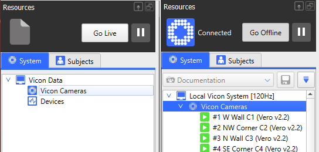

---
tags:
  - Vicon
  - Documentation
  - Live
  - Calibration
Section: "[[Public Files/Vicon System Documentation/system_preparation/index (system_preparation)|System Preparation]]"
Chapter: Calibrating Cameras
Chapter Number: "3"
Page Title: Calibrating Cameras
Page Number: "1"
Page Status: Draft
Software:
  - Vicon Nexus 2.18
Next Page:
  - "[[Public Files/Vicon System Documentation/system_preparation/3_calibrating/3_2_wand_waving|3_2_wand_waving]]"
  - "[[Public Files/Vicon System Documentation/system_preparation/4_volume/4_1_set_origin_and_plane|4_1_set_origin_and_plane]]"
Last Page:
  - "[[Public Files/Vicon System Documentation/system_preparation/1_masking/1_2_advanced_masking_and_reflections|1_2_advanced_masking_and_reflections]]"
  - "[[Public Files/Vicon System Documentation/system_preparation/1_masking/1_1_masking|1_1_masking]]"
---
---
```table-of-contents
```
---
---
# <span class="toc-header">Introduction</span>

**This quick-start guide covers:**
- How to start the calibration process
- How to calibrate cameras with the active wand (*IR version 2*)
- Effective wand-waving technique
- Calibration feedback and camera health (*in brief*)
- How to confirm a successful calibration

<span class="warning-text">Important - <b>this guide assumes you have already set your camera masks.</b></span>
If you have not yet masked your cameras, please complete this through the steps in one of the following guides:
- [Automatic masking](Public%20Files/Vicon%20System%20Documentation/system_preparation/1_masking/1_1_masking.md)
- [Manual masking](Public%20Files/Vicon%20System%20Documentation/system_preparation/1_masking/1_2_advanced_masking_and_reflections.md)

<span class="info-header">This is the second of the three-part quick-start system preparation guide:</span>
1. [Masking your Cameras](Public%20Files/Vicon%20System%20Documentation/system_preparation/1_masking/1_1_masking.md)
2. ***[Calibrating your Cameras](Public%20Files/Vicon%20System%20Documentation/system_preparation/3_calibrating/3_1_calibration_process.md)***
3. [Setting Volume Origin and Plane](Public%20Files/Vicon%20System%20Documentation/system_preparation/4_volume/4_1_set_origin_and_plane.md)

---
---
# <span class="toc-header">Camera Calibration (Quick-Start Guide)</span>
In order for you to begin capturing your subject's 3D motion tracking data, the cameras need to be calibrated to the environment you are working in.

The cameras are very sensitive to changes in temperature and light, as well as being physically disturbed. As such it is recommended that you calibrate at the beginning of any new day or capture session, and re-calibrate if the environment has changed or been disturbed.

Calibration is what allows each camera to determine the position of a tracked marker relative to itself, and the position of other cameras relative to itself. This positional data is synchronised between every camera in order to determine the 3D space (*the volume*) and where within that volume that the marker currently is.

---
---
## <span class="toc-header">Calibration Setup</span>
### <span class="toc-header">System State and Panel View</span>
In order to calibrate your cameras you must first ensure that you are in the correct system state.

**Offline mode** supports:
1. subject preparation
2. labelling and editing
3. trial pipelines

<span class="info-text">Live mode</span> supports:
1. <u>system preparation</u>
2. subject capture
3. trial capture

<u>For calibration and system preparation purposes you must ensure the system is in <span class="info-text">live mode</span>.</u>


<span class="image-caption">Vicon camera display state based on <u>offline</u> (left) and <u>live</u> (right) mode.</span>

If your cameras are not currently displaying under the '**Vicon Cameras**' device group, click the '<i>*<span class="info-text">Go live</span></i>' button to change system state.

Once you are ready to calibrate your cameras, look to **tools** panel on (by default) the right hand side, and make sure the **system preparation** tab is selected.


<span class="image-caption">Tools panel, in system preparation view</span>


<span class="image-caption">How to select the system preparation tab from the tools panel</span>

---
### <span class="toc-header">Resetting Calibration</span>
In order to ensure previous calibrations do not influence the day's calibration, you will need to remove the calibration profile from every camera.

<span class="warning-text">If this is <u>not</u> a brand new calibration, do not reset camera calibration. </span>
<span class="warning-text">This will remove all previous camera information about their relative position to each other and the volume.</span>

At the bottom of the **system preparation** tab you will see the **manage camera calibration** section.


Click the **Reset** button in . If you are in 3D Perspective view, and the cameras were previously calibrated, you will see the cameras either disappear or reposition into a straight line (depending on view option selected).

This represents that the cameras no longer know where each other are, relative to themselves.

<span class="warning-text">Do not select '<u>auto number cameras</u>' - this will reassign camera IDs and put them out of sync with the lab's physical labelling. </span>

---
### <span class="toc-header">Calibration Parameters</span>
Underneath the '**Calibrate Cameras**' section you will see ''*Show/Hide Advanced*" - ensure this is toggled to display all calibration properties.


<span class="image-caption">Calibrate cameras section with all properties displayed</span>

<span class="info-text">The properties here are as follows:</span>
- **Cameras to Calibrate**: *whether to calibrate all or specific cameras.*
- **Auto Stop Minimum Frames**: *the minimum number of frames a camera has to capture to end calibration.*
- **Auto Stop Minimum Frames (Video)**: *as above, but for video cameras - not relevant to this guide.*
- **Auto Stop** (*toggle*): *whether to use the auto-stop functionality above.*

<span class="warning-text">If this is your first calibration, use the following presets:</span>
- **Cameras to Calibrate**: All Cameras
- **Auto Stop Minimum Frames**: 1000
- **Auto Stop**: Yes ☑️

<span class="info-text">For more information on recalibration, calibrating individual cameras, or auto-stop:</span> check the [advanced calibration configuration](Public%20Files/Vicon%20System%20Documentation/system_preparation/3_calibrating/3_5_advanced_configuration.md) guide.

Once you are happy with these settings, start your camera calibration by clicking the *Start* button.


<span class="image-caption">Position of the calibration start button</span>

---
---
## <span class="toc-header">Calibrating with the Active Wand</span>

Once you begin your 

ENSURE IN STROBE NOT CONTINUOUS


<span class="image-caption">Initial calibration view with </span>

Show the ActiveWand
### <span class="toc-header">Wand Waving Best Practice</span>

Active Wand must be in Strobe mode for the standard calibration process.
Wave the wand throughout the capture volume so markers stay visible to the cameras

*The "frying-pan" technique (wand held flat, moved in a circular motion) is described as having been used with previous Active Wand versions (including v2)*

### <span class="toc-header">Successful Calibration</span>


Error calibration??

---
## <span class="toc-header">Calibration Feedback</span>

**Processing**

	   calibration will stop once all cameras hit the default 1000 frames by default
	   *once all cameras done the LED will reset*
	   cameras will turn green when they've done so you can update your attention
	   if camera is flashing then it needs more calibration frames
	   cameras flash faster when they're closer to hitting minimum auto-stop frames
	   
once you've done calibrating you'll see success
*images are collected for this already*
**they all turn blue, re-use this image from above**
**image of wand wave post-data** - note shown on Nexus

	   afterwards the calibration feedback will process, and this takes time
**Interface** - to view calibration feedback you may need to collapse previous sections

**image of success relative positions** - note to flip to 3d perspective
- User needs to switch to 3d perspective after calibration feedback data processes (**note**: slow in 2.18) to confirm that it works (note that if you reset, as you should have, you'll see nothing until this feedback does complete)

**Advanced doc/plane doc?**
You can export feedback data here but you can't get full calibration or origin set data until after you set with wand (not with marker)

---
# TODO

***System state probably doesn't belong in this guide, maybe in the intro UI guide/landing page guide or something?***
**Same for tools/system preparation sections**

Move to 3_5 [3_5_advanced_configuration](Public%20Files/Vicon%20System%20Documentation/system_preparation/3_calibrating/3_5_advanced_configuration.md)
* Cameras can be calibrated independently of each other
  *you can recalibrate specific cams to reintroduce to the vol-plane after reset or setting loss/bumping, a full setup recalibration is not needed*


text


text
## Questions to Answer for docs revision

**At least 3 cameras need to see a marker - does this have an impact on camera health based on wand wave position?**

- **To confirm**
  *You will always achieve better results by showing the wand to both sides of the volume at the same time, rather than separately to one side then the other.*

# More Note Dump
# TODO
Ensure notes about resetting calibration in calibration docs

Note you check 3d calibration after the feedback finishes not before, it doesn't update until then

*calibration allows cameras to determine their relative positions and focal lengths* <-- focal lengths?
## Reference Links
* **https://help.vicon.com/space/Nexus218/406488171/Calibrate+Vicon+cameras**
	  not in [Vicon Resources & Links](Private%20Files/Vicon%20Resources%20&%20Links.md)

